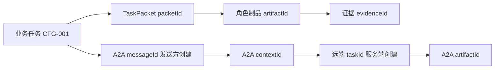

# Agent Harness Java

这是一个 Java 17 公开教学工程，用确定性本地 fixture 演示 AgentScope 工具循环、
跨进程恢复、角色交接，以及仅绑定环回地址的 A2A v1.0 HTTP+JSON 语义子集。
运行不需要模型 Key、Docker daemon、Nacos server 或远端服务。

## 最短成功路径

准备 Java 17，以及首次执行 Maven Wrapper 时需要的 `curl` 或 `wget`。Wrapper 使用
官方 only-script 3.3.4，锁定 Maven 3.9.11，并校验发行包 SHA-256。

```bash
./mvnw -s .mvn/settings.xml -gs .mvn/global-settings.xml \
  -Dmaven.repo.local="$PWD/.m2/repository" clean verify
```

两个 settings 文件只允许访问官方 Maven Central，不含 servers 或 proxies；依赖保存
在项目内已忽略的 `.m2/`。可执行文件是 `target/agent-harness-java.jar`。

## 五条旅程

### 1. 正常诊断：model → tool → model

```bash
java -jar target/agent-harness-java.jar diagnose \
  --state-root state/journey-1 --session journey-1
```

预期 `status=COMPLETE`、`modelCalls=2`，两个只读工具各调用一次，最终消息不再
包含 `ToolUseBlock`。

### 2. 证据不足

此命令使用独立新目录和新 session，避免读取旅程 1 已完成的状态：

```bash
java -jar target/agent-harness-java.jar diagnose \
  --state-root state/journey-2-missing --session journey-2-missing \
  --missing-request-evidence true
```

预期 `status=INSUFFICIENT_EVIDENCE`，请求事实为 `present=false`；程序不会补造
缺失事实。

### 3. 两个独立 Java 进程恢复

先运行第一个进程并在配置工具完成后退出：

```bash
java -jar target/agent-harness-java.jar resume \
  --state-root state/journey-3 --session journey-3 --stop-after config
```

再启动第二个进程，使用相同 state root 和 session：

```bash
java -jar target/agent-harness-java.jar resume \
  --state-root state/journey-3 --session journey-3
```

第二次预期 `status=COMPLETE`；持久化 `callCounts` 中配置工具仍为 1，请求事实
工具为 1。

### 4. 诊断、需求、开发、测试四角色协作

```bash
java -jar target/agent-harness-java.jar workflow \
  --state-root state/journey-4 --session journey-4 --scenario pass
```

预期路由为 `diagnosis → requirements → development → testing`。每个角色都有自己
的 ReActAgent 循环，并通过 `TaskPacket`、前置 artifact ID 和 evidence ID 交接。
`--scenario pending` 会在需求未冻结时停止；`--scenario incorrect` 会对错误教学
fixture 实际求值为 FAIL，再按测试制品回流到 development。

### 5. A2A：两个终端完成 server/client 往返

终端 A：

```bash
java -jar target/agent-harness-java.jar a2a-server \
  --state-root state/journey-5 --port 8080
```

终端 B：

```bash
java -jar target/agent-harness-java.jar a2a-send \
  --url http://127.0.0.1:8080 --message-id msg-001 \
  --context-id ctx-001 --business-task-id CFG-001 --text diagnose
```

预期 Card 为 `protocolVersion=1.0`，接口是 `/message:send` 和 `/tasks/{id}`；响应
包含服务端创建的 `taskId` 与 `artifactId`。

## 字段关系



`messageId` 由发送方创建，本示例不把它宣称为协议级幂等保证。`taskId`、
`contextId` 与业务任务 ID 是独立字段。后续消息使用新 `messageId`，并保持既有
`taskId`、`contextId` 和业务任务映射一致。

## 范围与安全边界

- 工具 allowlist 只有 `query_effective_config`、`query_request_facts` 和
  `produce_role_artifact`。前两项只读公开 fixture；最后一项明确写入本地教学制品状态。
- A2A server 只绑定 `127.0.0.1`。Client 只接受显式
  `http://127.0.0.1:<port>`，不跟随重定向；结果未知时不自动重发 Message。
- 状态 ID 与 A2A ID 使用有长度限制的 ASCII 白名单；JSON 由 Jackson 固定 record
  类型处理并拒绝重复字段；请求体、响应体和 HTTP 等待均有上限。Server 使用四个
  worker、八个排队槽，最多保留 64 个 Task 和 128 个 messageId；容量用尽时返回
  `SERVER_CAPACITY_REACHED`，超出执行队列的连接会被关闭。
- 应用状态使用随机临时文件原子替换和有界单 session 文件锁。状态根必须是 checkout
  内可信目录；AgentScope 固定状态文件及其 `.tmp` 文件在 Store 构造前和每次
  `agent.call` 前后都拒绝符号链接。本例只承诺单机约束，不承诺分布式并发，也不
  宣称能抵御同一 OS 用户主动并发置换文件系统对象。

这是 A2A v1.0 规范语义子集，不是完整 SDK 实现或互操作认证。v0.1 明确排除
SSE、gRPC、JSON-RPC、push、完整认证、Nacos、远端 LLM、Docker 和 `a2a-java`。

更多信息见 [产品范围](docs/product-scope.md)、[架构](docs/architecture.md)、
[安全边界](docs/security.md) 和 [验证证据](docs/verification.md)。

## License

Apache-2.0。第三方归属见 `NOTICE` 和 `THIRD_PARTY_NOTICES.md`。
