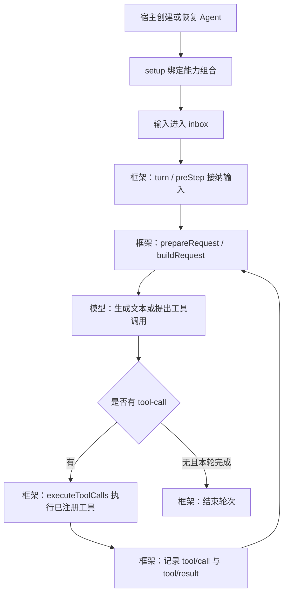

# dsh 源码解析：插件如何组成一个 Agent

源码基线：[`687f282e8625c6b8d11ff58211a90524be2e4317`](https://github.com/deepseek-ai/deepseek-harness/tree/687f282e8625c6b8d11ff58211a90524be2e4317)。本文是源码阅读，没有运行 dsh 或宣称完成其功能复现。

dsh 把运行职责也纳入插件组合：模型适配、工具注册、会话日志，以及驱动 Agent 的循环，都通过 Cordis 提供服务与扩展点。插件包含基础设施和策略，只有其中注册给模型的工具，才涉及模型选择调用。

## Profile 和 preset 分别装配什么

Profile 是 Harness home 中的具名应用组装。启动时叠加有序 bundle、profile patch、home patch 和命令行 patch，形成插件树。它可以选择 Web、Headless 或 SDK 等运行方式，不宜简单理解成模型环境。

Agent preset 定义一组子插件及展示信息，可以声明多套。初始化时，`AgentPreset` 把定义交给 `agentPresets.register()`；注册表提前加载组合并保留 revision。创建 Agent 时，`mount()` 将其作用域绑定到所选 revision。因此 preset 是能力组合定义，不是活跃 Agent 名单；修改定义也不代表全部存活实例立即换装。

源码：[整体架构](https://github.com/deepseek-ai/deepseek-harness/blob/687f282e8625c6b8d11ff58211a90524be2e4317/docs/architecture.zh.md)、[preset 声明](https://github.com/deepseek-ai/deepseek-harness/blob/687f282e8625c6b8d11ff58211a90524be2e4317/packages/preset/agent-preset/src/index.ts#L11-L29)、[组合注册和绑定](https://github.com/deepseek-ai/deepseek-harness/blob/687f282e8625c6b8d11ff58211a90524be2e4317/packages/preset/agent-preset-registry/src/index.ts#L81-L120)。

## 创建 Agent 与调用工具是两条路径

`ctx.agents` 管理活跃实例并转交创建请求，默认 `AgentLoop` 实现工厂。`createAgent()` 准备会话、取得可用持久化写句柄、执行 setup，然后发布实例。setup 可以在实例公开前完成作用域配置。Agent 与会话日志使用同一身份，但持久会话可以在没有活跃 Agent 时存在。

模型选择工具时，只进入工具执行路径。它不会因为工具来自某插件，就自动创建该插件定义的 Agent。子 Agent 需要明确的委派入口，父历史是否带入取决于 provider 能力与具体实现。

源码：[创建实例](https://github.com/deepseek-ai/deepseek-harness/blob/687f282e8625c6b8d11ff58211a90524be2e4317/packages/core/agent-loop/src/index.ts#L744-L786)、[AgentRegistry](https://github.com/deepseek-ai/deepseek-harness/blob/687f282e8625c6b8d11ff58211a90524be2e4317/packages/core/agent/src/index.ts#L348-L419)、[子 Agent 子系统](https://github.com/deepseek-ai/deepseek-harness/blob/687f282e8625c6b8d11ff58211a90524be2e4317/docs/subsystems/subagent.zh.md)。

## 输入如何走完一轮

这是默认主路径示意，省略取消、重试与控制信号。`ReactLoopAgent.turn()` 驱动步骤；`preStep()` 组装提示词与工具 schema 并接纳输入；`step()` 准备模型调用，提交 assistant message，并在出现工具调用时执行与记录工具结果。

模型决定输出和提出哪些工具调用；框架负责请求构造、派发、记录和推进。一个轮次可以请求模型多次，没有固定的“两次”规则。

源码：[模型与工具分支](https://github.com/deepseek-ai/deepseek-harness/blob/687f282e8625c6b8d11ff58211a90524be2e4317/packages/core/agent-loop/src/agent.ts#L400-L555)、[工具日志提交](https://github.com/deepseek-ai/deepseek-harness/blob/687f282e8625c6b8d11ff58211a90524be2e4317/packages/core/agent-loop/src/tool-calls.ts#L263-L285)。

## 两种上下文

Cordis `Context` 承载服务、事件和作用域；模型上下文是某次请求的提示词、消息与工具定义。`buildRequest()` 调用 `session.deriveMessages()`，从会话日志投影历史，再构造模型请求。

多个 Agent 可以复用同一组合定义，不因此共享同一份历史。复制、注入与跨 Agent 传递需要明确机制。插件通过获得的接口和作用域参与运行，不能概括为所有插件共享所有上下文。

源码：[请求构造](https://github.com/deepseek-ai/deepseek-harness/blob/687f282e8625c6b8d11ff58211a90524be2e4317/packages/core/agent-loop/src/agent.ts#L680-L703)。

## Java 案例对应到哪里

| dsh 阅读点 | 本仓库 AgentScope 示例 |
| --- | --- |
| 宿主装配 | `bootstrap.Main` 创建具体 Gateway |
| 默认运行循环 | `AgentScopeGateway` 使用 `ReActAgent` |
| 工具注册和执行 | `DateTool` 适配领域日期规则 |
| 会话身份与状态 | 独立 UUID 和内存状态存储 |
| Profile / preset / Cordis 插件作用域 | 本示例未实现这些系统 |

dsh 的核心实现使用 TypeScript 和 Cordis；Java 示例依赖 AgentScope，二者没有直接实现或运行时关系。我们对照职责，不宣称照搬了 dsh 插件系统。

上游采用 [MIT 许可](https://github.com/deepseek-ai/deepseek-harness/blob/687f282e8625c6b8d11ff58211a90524be2e4317/LICENSE)。本文采用原创解释和固定版本链接，没有复制源码树；未来复制实质源码时须保留版权与许可，并另核对 [第三方声明](https://github.com/deepseek-ai/deepseek-harness/blob/687f282e8625c6b8d11ff58211a90524be2e4317/THIRD_PARTY_NOTICES.md)。
