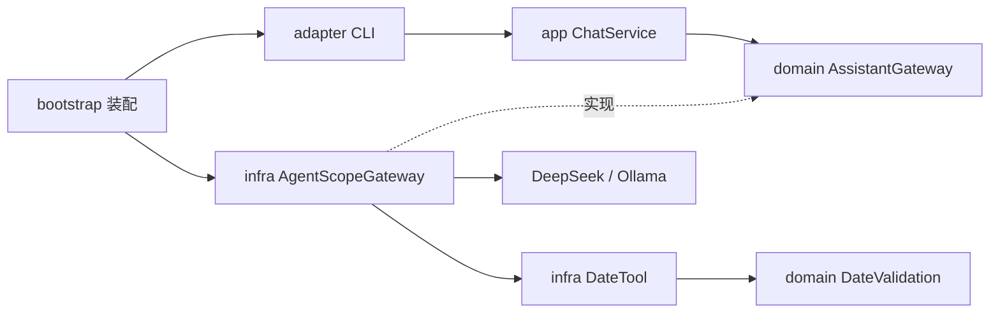

# AgentScope Java：按 DDD 分层的通用助手

这个案例可以自由聊天，需要校验日期时由模型选择 `check_date` 工具。DeepSeek 和本地 Ollama 共用代码、工具和提示词，只切换接入配置。

使用 Java 17、AgentScope Java 2.0.4。为了方便阅读，先采用一个 Maven 工程内的包分层，未拆成多个模块。这里借鉴常见后端项目的 DDD 依赖方向，不包含任何企业业务实现或配置。

## 启动

先安装 JDK 17，克隆仓库：

```bash
git clone https://github.com/nemoob/agent-harness-java.git
cd agent-harness-java
# 通过待合并 PR 试用时，先 git checkout 对应分支
cd examples/agentscope-ddd
```

### DeepSeek

在当前终端通过系统密钥管理工具或环境变量设置 `DEEPSEEK_API_KEY`，不要把真实密钥写进仓库、截图或命令历史。macOS 默认 zsh 可以隐藏输入：

```zsh
read -s 'DEEPSEEK_API_KEY?DeepSeek API key: '
echo
export DEEPSEEK_API_KEY
./run.sh deepseek
```

默认模型在 `config/application.properties`，可以用 `DEEPSEEK_MODEL` 覆盖为账号可用的模型 ID。使用 DeepSeek 会产生服务商的 API 费用。

### 本地 Ollama

安装并启动 [Ollama](https://docs.ollama.com/)，在另一个终端准备支持工具调用的模型：

```bash
ollama serve  # 已由桌面应用启动时无需重复运行
ollama pull qwen2.5:7b
```

回到示例目录启动：

```bash
./run.sh ollama
# 已有其他支持工具调用的模型时：
OLLAMA_MODEL=qwen2.5:0.5b ./run.sh ollama
```

默认只访问 `127.0.0.1:11434`。模型下载和首次 Maven 依赖下载需要联网；文件准备好以后，本地推理不需要 DeepSeek 密钥。小模型可能答错、忽略工具或无法保持多轮上下文，连通不等于任务正确。

两种方式都可以依次输入：

```text
你好，用一句话介绍一下自己。
请调用工具检查 2025-02-29 和 2024-02-29 是否有效。
只列出刚才两个日期和结果，不要重新校验。
/exit
```

`[模型 #N]` 记录当前进程累计模型阶段；`[工具执行]` / `[工具结果]` 来自真实工具方法；`[结束]` 展示框架结束原因。回答正确不证明工具执行过，`MAX_ITERATIONS` 也不代表任务成功。

## 代码从哪里读

```text
src/main/java/dev/agentharness/demo/
├── bootstrap/Main.java             启动、读取配置、装配对象
├── adapter/ChatCli.java             终端输入输出
├── app/ChatService.java             输入校验与调用组织
├── domain/AssistantGateway.java     模型助手端口
├── domain/DateValidation.java       确定性日期规则
├── dto/AssistantReply.java          文本与结束原因
└── infra/
    ├── AgentScopeGateway.java      Agent Loop、会话、两种模型接入
    ├── DateTool.java               框架工具适配领域规则
    ├── ModelTrace.java             模型调用观测
    └── AppConfig.java              配置加载和验证
```

编译依赖与运行调用需要分开看：



运行时 `ChatService` 调用领域端口，实际执行的是装配进去的 `AgentScopeGateway`。模型提出工具调用后，框架派发到 `DateTool`，工具调用纯 Java 日期规则，再把结果交回模型。领域层不反向依赖基础设施；工具也不回调整个聊天应用，以免形成循环。

DDD 在这里用于讲清职责和依赖，日期校验不需要硬凑聚合、仓储或领域事件。复杂业务确实出现后，再增加相应模型。

## 配置和边界

| 配置 | 来源与优先级 |
| --- | --- |
| 供应商 | `./run.sh deepseek` 或 `./run.sh ollama`；省略默认 DeepSeek |
| 模型名称 | 对应环境变量高于 `config/application.properties` |
| DeepSeek 密钥 | 仅 `DEEPSEEK_API_KEY` 环境变量 |
| 提示词、超时、迭代上限、输出上限 | `config/application.properties`；提示词正文默认 `config/system-prompt.txt` |

修改配置后重新启动。提示词控制期望行为，实际能力由 `Toolkit.registerTool()` 决定。格式校验无法识别模型擅自猜测的用户意图。

每个 CLI 进程创建一个 Agent，使用进程内固定、每次启动随机生成的 UUID 身份和内存状态存储完成连续对话。退出后历史不保留；多个进程不共享上下文。本例不实现插件管理器、子 Agent、MCP、自动压缩或持久记忆，不把一个入门案例伪装成完整平台。

采用非流式响应、单次模型尝试；模型等待上限和整轮上限分别配置。整轮取消不能保证远端立即停止，失败时 CLI 结束，不继续复用可能尚在收尾的实例。输入长度限制也不能代替多轮 token 预算，长聊请退出后重新启动。

## 验证与排错

从仓库根目录运行，无需模型或密钥：

```bash
./mvnw -f examples/agentscope-ddd/pom.xml test
```

测试覆盖日期边界、含糊参数、输入拦截、配置选择与依赖方向；不把这些测试算作真实模型验收。真实运行记录见 [验证记录](../../docs/agentscope-ddd-verification.md)。

| 现象 | 检查 |
| --- | --- |
| 启动前失败 | Java 是否为 17；配置值和提示词路径是否有效；DeepSeek 密钥是否已设置 |
| 模型开始后失败 | 密钥权限、模型 ID、服务可达性与超时；不要公开供应商原始响应中的秘密 |
| Ollama 连接失败 | `ollama list` 是否可连接；服务是否监听 11434 |
| 找不到本地模型 | `ollama list` 与 `OLLAMA_MODEL` 是否一致 |
| 有答案但没有工具日志 | 模型可能未调用工具，换明确输入或能力更强的模型观察 |
| 达到循环上限 | 检查实际工具结果和结束原因，不要把收尾文字直接当成功 |

阅读 [dsh 源码解析](../../docs/dsh-source-analysis.md) 可以对照另一种插件架构。dsh 使用 TypeScript/Cordis，本例使用 AgentScope Java，二者没有运行时依赖。
