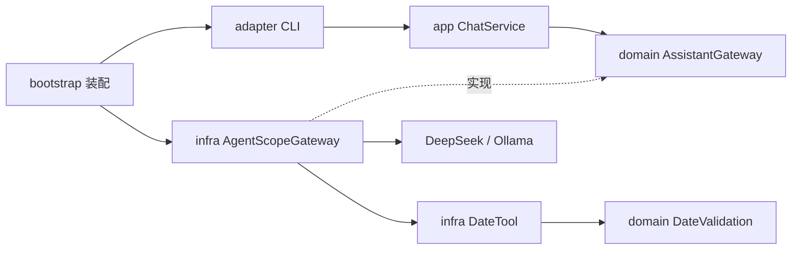

# AgentScope Java：按 DDD 分层的通用助手

这个案例可以自由聊天，需要校验日期时由模型选择 `check_date` 工具。DeepSeek 和本地 Ollama 共用代码、工具和提示词，只切换接入配置。

使用 Java 17、AgentScope Java 2.0.4。为了方便阅读，先采用一个 Maven 工程内的包分层，未拆成多个模块。这里借鉴常见后端项目的 DDD 依赖方向，不包含任何企业业务实现或配置。

## 启动

先安装 JDK 17，克隆仓库：

```bash
git clone https://github.com/nemoob/agent-harness-java.git
cd agent-harness-java
# 通过待合并 PR 试用时，先 git checkout 对应分支
cd examples/agentscope-ddd
```

### DeepSeek

在当前终端通过系统密钥管理工具或环境变量设置 `DEEPSEEK_API_KEY`，不要把真实密钥写进仓库、截图或命令历史。macOS 默认 zsh 可以隐藏输入：

```zsh
read -s 'DEEPSEEK_API_KEY?DeepSeek API key: '
echo
export DEEPSEEK_API_KEY
./run.sh deepseek
```

默认模型在 `config/application.properties`，可以用 `DEEPSEEK_MODEL` 覆盖为账号可用的模型 ID。使用 DeepSeek 会产生服务商的 API 费用。

### 本地 Ollama

安装并启动 [Ollama](https://docs.ollama.com/)，在另一个终端准备支持工具调用的模型：

```bash
ollama serve  # 已由桌面应用启动时无需重复运行
ollama pull qwen2.5:7b
```

回到示例目录启动：

```bash
./run.sh ollama
# 已有其他支持工具调用的模型时：
OLLAMA_MODEL=qwen2.5:0.5b ./run.sh ollama
```

默认只访问 `127.0.0.1:11434`。模型下载和首次 Maven 依赖下载需要联网；文件准备好以后，本地推理不需要 DeepSeek 密钥。小模型可能答错、忽略工具或无法保持多轮上下文，连通不等于任务正确。

### 备注：换用其他模型

当前示例只实现 `deepseek` 和 `ollama` 两个启动选项。换同一接入方式下的模型，与增加模型供应商，是两件不同的事。

| 接入情况 | 怎么做 |
| --- | --- |
| DeepSeek 的其他可用模型 | 用 `DEEPSEEK_MODEL` 指定账号可用的模型 ID，或修改 `deepseek.model`，再重新启动 |
| Ollama 中的其他本地模型 | 先下载并用 `ollama list` 核对名称，再用 `OLLAMA_MODEL` 指定完整模型标签；工具案例应选择支持工具调用的模型 |
| 提供 OpenAI Chat Completions 兼容接口的服务 | 扩展 `AppConfig` 的供应商白名单、模型和密钥配置；在 `AgentScopeGateway` 中使用对应模型适配器，设置可信的服务地址、密钥和模型 ID |
| 使用其他协议的服务 | 先确认 AgentScope Java 对应版本是否提供适配模块，在 `pom.xml` 添加同版本依赖，再补配置与 Gateway 装配；没有适配器时需要自行实现基础设施适配 |

新增供应商时，主要修改 `AppConfig.java`、`AgentScopeGateway.java`，必要时修改 `pom.xml`；领域日期规则与上层用例通常无需改动。具体模型适配方式见 [AgentScope 模型接入说明](https://github.com/agentscope-ai/agentscope-java/blob/main/docs/v2/en/integration/model/openai.md)，阅读时应核对本例固定的 2.0.4 版本。

注意：当前代码没有通用 `BASE_URL` 配置，不能只设置一个环境变量就切换第三方服务，也不能直接运行 `./run.sh openai`。扩展时服务地址应来自开发者维护的可信配置，不由聊天输入指定；密钥从环境变量或密钥管理读取。DeepSeek 专用的 `thinking` 参数也不要照搬给其他供应商。兼容接口仍需核对路径、工具参数、响应格式和结束原因，不能仅凭普通聊天成功判断工具调用兼容。

换模型后，依次验证普通问答、一次明确的日期工具调用、复用已有结果的追问，再核对工具参数、返回值与最终回答是否一致。研发助手和 A2A 还要分别验证自己的任务与超时边界。其他供应商在本例中仅给出接入方法，尚未实现或实测；不要把框架支持等同于本案例已经支持。

两种方式都可以依次输入：

```text
你好，用一句话介绍一下自己。
请调用工具检查 2025-02-29 和 2024-02-29 是否有效。
只列出刚才两个日期和结果，不要重新校验。
/exit
```

`[模型 #N]` 记录当前进程累计模型阶段；`[工具执行]` / `[工具结果]` 来自真实工具方法；`[结束]` 展示框架结束原因。回答正确不证明工具执行过，`MAX_ITERATIONS` 也不代表任务成功。

## 代码从哪里读

```text
src/main/java/dev/agentharness/demo/
├── bootstrap/Main.java             启动、读取配置、装配对象
├── adapter/ChatCli.java             终端输入输出
├── app/ChatService.java             输入校验与调用组织
├── domain/AssistantGateway.java     模型助手端口
├── domain/DateValidation.java       确定性日期规则
├── dto/AssistantReply.java          文本与结束原因
└── infra/
    ├── AgentScopeGateway.java      Agent Loop、会话、两种模型接入
    ├── DateTool.java               框架工具适配领域规则
    ├── ModelTrace.java             模型调用观测
    └── AppConfig.java              配置加载和验证
```

编译依赖与运行调用需要分开看：



运行时 `ChatService` 调用领域端口，实际执行的是装配进去的 `AgentScopeGateway`。模型提出工具调用后，框架派发到 `DateTool`，工具调用纯 Java 日期规则，再把结果交回模型。领域层不反向依赖基础设施；工具也不回调整个聊天应用，以免形成循环。

DDD 在这里用于讲清职责和依赖，日期校验不需要硬凑聚合、仓储或领域事件。复杂业务确实出现后，再增加相应模型。

## 配置和边界

| 配置 | 来源与优先级 |
| --- | --- |
| 供应商 | `./run.sh deepseek` 或 `./run.sh ollama`；省略默认 DeepSeek |
| 模型名称 | 对应环境变量高于 `config/application.properties` |
| DeepSeek 密钥 | 仅 `DEEPSEEK_API_KEY` 环境变量 |
| 提示词、超时、迭代上限、输出上限 | `config/application.properties`；提示词正文默认 `config/system-prompt.txt` |

修改配置后重新启动。提示词控制期望行为，实际能力由 `Toolkit.registerTool()` 决定。格式校验无法识别模型擅自猜测的用户意图。

每个 CLI 进程创建一个 Agent，使用进程内固定、每次启动随机生成的 UUID 身份和内存状态存储完成连续对话。退出后历史不保留；多个进程不共享上下文。本例不实现插件管理器、子 Agent、MCP、自动压缩或持久记忆，不把一个入门案例伪装成完整平台。

采用非流式响应、单次模型尝试；模型等待上限和整轮上限分别配置。整轮取消不能保证远端立即停止，失败时 CLI 结束，不继续复用可能尚在收尾的实例。输入长度限制也不能代替多轮 token 预算，长聊请退出后重新启动。

## 验证与排错

从仓库根目录运行，无需模型或密钥：

```bash
./mvnw -f examples/agentscope-ddd/pom.xml test
```

测试覆盖日期边界、含糊参数、输入拦截、配置选择与依赖方向；不把这些测试算作真实模型验收。真实运行记录见 [验证记录](../../docs/agentscope-ddd-verification.md)。

| 现象 | 检查 |
| --- | --- |
| 启动前失败 | Java 是否为 17；配置值和提示词路径是否有效；DeepSeek 密钥是否已设置 |
| 模型开始后失败 | 密钥权限、模型 ID、服务可达性与超时；不要公开供应商原始响应中的秘密 |
| Ollama 连接失败 | `ollama list` 是否可连接；服务是否监听 11434 |
| 找不到本地模型 | `ollama list` 与 `OLLAMA_MODEL` 是否一致 |
| 有答案但没有工具日志 | 模型可能未调用工具，换明确输入或能力更强的模型观察 |
| 达到循环上限 | 检查实际工具结果和结束原因，不要把收尾文字直接当成功 |

阅读 [dsh 源码解析](../../docs/dsh-source-analysis.md) 可以对照另一种插件架构。dsh 使用 TypeScript/Cordis，本例使用 AgentScope Java，二者没有运行时依赖。

## 选做研发助手

运行 `./run-repair.sh deepseek` 或 `./run-repair.sh ollama`，让 Agent 修复自带练习的日期解析缺陷。范围、真实测试与安全边界见 [选做实战](../../docs/repair-assistant.md)。

## A2A 日期服务

在一个终端运行 `./run-a2a.sh server deepseek`，另一个终端运行 `./run-a2a.sh client 2025-02-29`。服务端也可选 `ollama`；客户端无需模型密钥。分层、协议、真实日志和模型质量边界见 [A2A DDD 指南](../../docs/a2a-ddd.md)。它只接日期工具，修复助手保持本地入口。


## 第五、八章离线实验

先装 Java 17；`run-lab.sh` 只用 `javac` 与 `java` 编译实验类及日期规则，不下载 Maven 依赖，不读取模型配置。它不改变通用助手、研发助手或 A2A 的运行行为。

```bash
./run-lab.sh loop normal
./run-lab.sh loop bad-id
./run-lab.sh loop missing-result
./run-lab.sh loop limit
./run-lab.sh context
```

正常 Loop 退出 0；后三个 Loop 故障场景预期退出 2。不要把预期故障写成测试未通过。上下文实验以完整教学请求的 UTF-8 字节计量预算，比较不裁剪、简单截尾和完整片段选择，最终汇总实际收到的工具结果；不是供应商 token 计数，也不是已接入 AgentScope 的自动压缩。

源码在 `src/main/java/dev/agentharness/demo/lab/`。`MinimalLoop` 展示接续，`Message` 校验调用关系，`ContextSelection` 选择片段，`LabMain` 准备可重复场景。全书其他章节对应的工程与命令见[章节与代码入口](../../docs/chapter-entrypoints.md)。

原始命令与退出码见[离线运行记录](../../docs/evidence/loop-context-lab-20261024.json)。聚焦测试：`../../mvnw -q -o -Dtest=LoopContextTest test`；首次 Maven 测试需先准备依赖，离线脚本本身不需要。

片段主题由调用方显式指定：每个 required topic 选择最新完整片段，剩余额度再按时间从近到远补充整段，最后恢复原时间顺序；未完成工具链先等待回填，缺少必要主题则停止。这不是语义检索。

## 第十二、十八、十九章：完整实验入口

以下命令均在本目录运行，使用 Java 17；请先确认 `java -version`、`javac -version` 与 `JAVA_HOME` 指向同一套 JDK。真实 DeepSeek 调用沿用上面的环境变量配置，不把密钥写入文件或命令参数。

| 目标 | 命令 | 验收要看什么 |
| --- | --- | --- |
| 规则与实现调查，再交接受限修复 | `./run-investigation.sh deepseek` | 两份只读工具证据、冲突汇总、真实失败基线、修改差异及最终重新编译测试 |
| 构建本机部署产物 | `./run-operations.sh build` | 固定 JAR、运行依赖与配置摘要 |
| 不调用模型的部署实验 | `./run-operations.sh offline` | 真实 HTTP、认证拒绝、请求关联、SIGTERM 与退出清理 |
| 真实模型部署实验 | `./run-operations.sh experiment` | 实际模型与工具调用、HTTP 结果，以及随后独立的进程停止证据 |
| 五题、两版、每版三次评测 | `./run-evaluation.sh deepseek` | 先冻结清单，再保留全部 30 个 trial、逐项判分、耗时及可取得的用量 |

Operations 构建采用 Maven 离线模式。首次使用先联网准备依赖和插件：

```bash
../../mvnw -f pom.xml -DskipTests package dependency:copy-dependencies
```

依赖准备好后再运行表中的命令。Operations 是本机固定产物与停止信号实验，没有验证 Docker、跨机器部署或供应商远端取消。真实模型运行需要联网并产生费用；不要把 `offline` 的成功算成模型验证。

调查任务沿用固定练习与现有 `RepairService`，没有任意目录、Shell 或修改测试的权限。两个只读调查 Agent 与修复 Agent 使用独立实例；程序按工具事实交接，模型审查文字不会直接成为执行指令。

评测入口只接受 DeepSeek，五题均为完整日期，不能据此推导含糊输入、长期记忆或其他模型上的质量。A/B 比较使用相同用户要求；格式、工具遵循与事实一致性分别保留判定依据。完整原始记录在本目录的 `docs/evidence/`，每次正式复跑前先归档已有结果，禁止用新结果覆盖第一次失败。

仓库保留了作者的正式记录，入口会拒绝覆盖。自己复跑时，先把现有清单和结果移到新建的备份目录（保留其他历史失败文件）：

```bash
backup="docs/evidence/archive-$(date +%Y%m%d-%H%M%S)"
mkdir "$backup"
for file in evaluation-manifest.json evaluation-results.json; do
  if [ -f "docs/evidence/$file" ]; then
    mv "docs/evidence/$file" "$backup/"
  fi
done
./run-evaluation.sh deepseek prepare
# 查看生成的 evaluation-manifest.json，再启动这组付费评测。
./run-evaluation.sh deepseek
```

`prepare` 不调用模型。正式运行会核对清单与当前源码、配置；更改提示词后须重新准备清单，并保留上一份记录。30 个 trial 不等于 30 次模型调用，工具后的答复通常还需要下一次模型调用。

本次作者运行记录（2026 年 10 月 25 日）：

- [调查与受限修复](docs/evidence/investigation-deepseek-1792893886048-c7eeb750-6954-4116-8cf9-de34f2c8af10.json)：原始 7 项测试中 3 项失败，修复后重新编译，7/7 通过。
- [真实服务与停止验收](docs/evidence/operations-local.json)及[原始阶段日志](docs/evidence/operations-local.log)：DeepSeek 日期工具实际执行，HTTP 结果核对通过；之后 SIGTERM 使进程在 1 秒内退出并清理连接文件。
- [评测清单](docs/evidence/evaluation-manifest.json)与[全部 30 条结果](docs/evidence/evaluation-results.json)：A、B 各 15/15；共 60 次模型调用、30 次工具执行。B 比 A 多用 510 token，本题集未显示质量收益，因此没有据此采用更复杂的提示词。费用未知。

以上是固定版本、固定题目的运行证据，不是通用成功率或性能排名。评测启动前发生过一次数字类型校验错误，修复前的清单和 0-trial 失败记录也保留在证据目录中，没有算进正式试次。
